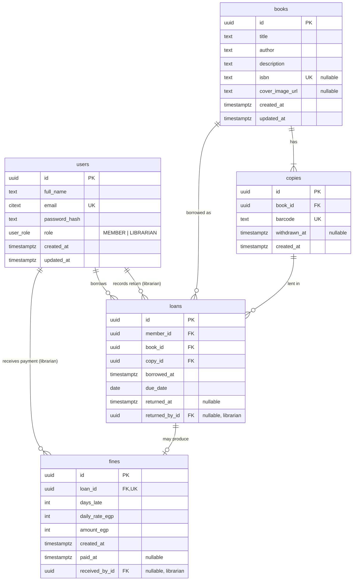

# Database Design

The database is PostgreSQL ([T002](../tdrs/T002-postgresql-database.md)), accessed only
through the repository layer with Prisma ([T004](../tdrs/T004-prisma-orm.md),
[architecture](architecture.md)). Every table and constraint below traces back to a PRD
in [`../prds`](../prds/README.md).

## Why PostgreSQL: ACID

Borrowing and fines are about scarce copies and money, so partial or conflicting writes
are not acceptable:

| Property | What it protects in this system |
| --- | --- |
| **Atomicity** | A borrow creates the loan *and* takes the copy, or does nothing. A return closes the loan *and* creates its fine, or does nothing. |
| **Consistency** | Constraints reject invalid states: a copy on two active loans, a negative fine, a loan without a member. |
| **Isolation** | Two members borrowing the last copy at the same moment can't both succeed (P005). One member can't pass the 3-book limit by borrowing from two tabs at once (P006). |
| **Durability** | Once a loan or fine payment is committed, it survives crashes. Fines are money and must never be lost. |

## Entity Relationship Diagram



## Relationships

| Relationship | Cardinality | Meaning |
| --- | --- | --- |
| books → copies | 1 to 1..N | A book has at least one physical copy (P005). |
| copies → loans | 1 to 0..N | A copy is lent many times over its life, but has **at most one active loan** at a time. |
| users → loans (member) | 1 to 0..N | A member has many loans over time, **at most 3 active** (P006). |
| books → loans | 1 to 0..N | Stored on the loan so "one active loan per book per member" can be a constraint (P006-Q1). |
| users → loans (returned_by) | 1 to 0..N | The librarian who recorded the return (P008). |
| loans → fines | 1 to 0..1 | A loan returned late produces exactly one fine (P009). |
| users → fines (received_by) | 1 to 0..N | The librarian who marked the fine as paid (P010). |

## Tables

### `users`

Members and librarians (P001, P003).

| Column | Type | Rules |
| --- | --- | --- |
| `id` | `uuid` | PK, default `gen_random_uuid()` |
| `full_name` | `text` | Not null (P001-Q1) |
| `email` | `citext` | Not null, **unique**, case-insensitive (P001) |
| `password_hash` | `text` | Not null. Never the plain password (P001) |
| `role` | `user_role` enum | `MEMBER` \| `LIBRARIAN`, default `MEMBER` (P003) |
| `created_at`, `updated_at` | `timestamptz` | Not null |

### `books`

Catalog titles (P004).

| Column | Type | Rules |
| --- | --- | --- |
| `id` | `uuid` | PK |
| `title` | `text` | Not null; indexed for search (P004-Q1) |
| `author` | `text` | Not null; indexed for search (P004-Q1). Multiple authors are stored as one display string in v1. |
| `description` | `text` | Not null, may be empty |
| `isbn` | `text` | Nullable, unique when present |
| `cover_image_url` | `text` | Nullable |
| `created_at`, `updated_at` | `timestamptz` | Not null |

### `copies`

Physical items of a book (P005).

| Column | Type | Rules |
| --- | --- | --- |
| `id` | `uuid` | PK |
| `book_id` | `uuid` | FK → `books.id`, not null, `ON DELETE RESTRICT` |
| `barcode` | `text` | Not null, **unique**. The label the librarian scans or reads. |
| `withdrawn_at` | `timestamptz` | Nullable. Set when a copy is removed from circulation (lost, damaged). Withdrawn copies keep their loan history but can't be borrowed. |
| `created_at` | `timestamptz` | Not null |

Availability is **not stored**. It is derived (P005):

```
available copies = copies of the book
                   where withdrawn_at is null
                   and no loan with returned_at is null
```

Storing an `is_available` flag would duplicate the truth and could drift.

### `loans`

One borrow of one copy by one member (P006, P007, P008).

| Column | Type | Rules |
| --- | --- | --- |
| `id` | `uuid` | PK |
| `member_id` | `uuid` | FK → `users.id`, not null |
| `book_id` | `uuid` | FK → `books.id`, not null; must match the copy's book (see constraints) |
| `copy_id` | `uuid` | FK → `copies.id`, not null |
| `borrowed_at` | `timestamptz` | Not null |
| `due_date` | `date` | Not null. Borrow date in Cairo time + 14 days (P007) |
| `returned_at` | `timestamptz` | Nullable. `null` = **active loan** |
| `returned_by_id` | `uuid` | FK → `users.id`, nullable. Librarian who recorded the return (P008) |

A loan is **overdue** when `returned_at is null` and today (Cairo) > `due_date`. This is
computed, not stored.

### `fines`

Created when a late book is returned (P009); settled in person (P010).

| Column | Type | Rules |
| --- | --- | --- |
| `id` | `uuid` | PK |
| `loan_id` | `uuid` | FK → `loans.id`, not null, **unique** (one fine per loan) |
| `days_late` | `int` | Not null, `> 0` |
| `daily_rate_egp` | `int` | Not null, `> 0`. The rate at the time of return (5 EGP today, P009) |
| `amount_egp` | `int` | Not null. Whole Egyptian pounds, never floats (T002) |
| `created_at` | `timestamptz` | Not null |
| `paid_at` | `timestamptz` | Nullable. `null` = **unpaid** |
| `received_by_id` | `uuid` | FK → `users.id`, nullable. Librarian who took the payment (P010-Q1) |

Storing `daily_rate_egp` keeps old fines correct if the rate changes in a future PRD.

The **running fine** of a book that is still out (P009) is computed on read
(`days overdue × 5`); a `fines` row exists only once the book is returned and the amount
is final.

## Constraints

Rules the database enforces itself, so a bug in application code can't break them:

| Constraint | SQL | Rule |
| --- | --- | --- |
| One active loan per copy | `UNIQUE (copy_id) WHERE returned_at IS NULL` | A copy is never lent twice at once (P005) |
| One active loan per book per member | `UNIQUE (member_id, book_id) WHERE returned_at IS NULL` | No second copy of the same book (P006-Q1) |
| Loan's book matches its copy | `UNIQUE (id, book_id)` on `copies` + composite FK `loans (copy_id, book_id) → copies (id, book_id)` | `loans.book_id` can't disagree with the copy |
| Return after borrow | `CHECK (returned_at IS NULL OR returned_at >= borrowed_at)` | |
| Return has a librarian | `CHECK ((returned_at IS NULL) = (returned_by_id IS NULL))` | P008-Q1 |
| Fine amount is correct | `CHECK (amount_egp = days_late * daily_rate_egp)` | P009 |
| Fine is positive | `CHECK (days_late > 0 AND daily_rate_egp > 0)` | No zero fines for on-time returns |
| Payment has a librarian | `CHECK ((paid_at IS NULL) = (received_by_id IS NULL))` | P010-Q1 |
| Unique email | `UNIQUE (email)` on `citext` | P001 |
| No deleting history | `ON DELETE RESTRICT` on all FKs | Loans and fines are records; books, copies, and users with history can't be deleted |

Partial unique indexes and composite FKs can't all be expressed in the Prisma schema; they
are added as SQL in a Prisma migration (T004).

The **3-book limit** (P006) can't be a single constraint because it counts rows. It is
enforced in the service layer inside a transaction (see below).

## Indexes

| Index | Used by |
| --- | --- |
| `loans (member_id) WHERE returned_at IS NULL` | Count active loans, "My loans" (P006, P007) |
| `loans (due_date) WHERE returned_at IS NULL` | Find overdue loans (P006-Q2, P011) |
| `fines (loan_id) WHERE paid_at IS NULL` | Find unpaid fines for a member (P010-Q2) |
| `copies (book_id)` | Availability per book (P005) |
| Trigram (`pg_trgm`) on `books.title`, `books.author` | Partial-match search (P004-Q1) |

## Transactions

Every multi-step write runs in one transaction (T002).

### Borrow (P005, P006, P007, P010)

```
BEGIN
  SELECT … FROM users WHERE id = :member FOR UPDATE    -- serialize this member's borrows
  check: no active loan with due_date < today            -- P006-Q2
  check: no fine with paid_at is null                    -- P010-Q2
  check: count(active loans) < 3                         -- P006
  pick an available, non-withdrawn copy of the book      -- P005
  INSERT loan (due_date = today + 14)                    -- P007
COMMIT
```

- Locking the member row makes two simultaneous borrows by the same member run one after
  the other, so both can't see "2 active loans" and both succeed.
- If two *different* members take the last copy at the same moment, the
  "one active loan per copy" index rejects the second insert. The service turns that into
  "This book is currently unavailable."

### Return (P008, P009)

```
BEGIN
  UPDATE loans SET returned_at = now(), returned_by_id = :librarian
    WHERE id = :loan AND returned_at IS NULL
  if returned late: INSERT fine (days_late, daily_rate_egp = 5, amount_egp)
COMMIT
```

### Pay fine (P010)

```
UPDATE fines SET paid_at = now(), received_by_id = :librarian
  WHERE id = :fine AND paid_at IS NULL
```

## Conventions

- Table and column names are `snake_case`, tables plural. Prisma models are `PascalCase`
  and mapped to these names.
- Primary keys are UUIDs generated by PostgreSQL.
- All timestamps are `timestamptz` stored in UTC; "dates" for loans (`due_date`) are
  calendar dates in the `Africa/Cairo` time zone (P007).
- Money is `int` whole EGP (T002).
- Nothing is hard-deleted once it has history; copies are withdrawn instead (`withdrawn_at`).

## Not modeled yet

- **Sessions / auth tables**: depend on the authentication library, which needs its own
  TDR.
- Reservations (P005-Q1), renewals (P007-Q2), and categories (P004-Q1) are out of scope
  for v1.
